**Analysis of AI‑Generated Texts vs. Human‑Written Texts**

| **Dataset**      | AI vs. Human Text — Kaggle (Shane Gerami)                     |
| ---------------- | ------------------------------------------------------------- |
| **Technologies** | HDFS · YARN · MapReduce · Hive (Beeline) · Kerberos · Parquet |

# **1. Context and Use‑Case**

## **1.1 Problem Statement**

In artificial intelligence, a worrying phenomenon has emerged: when a language model is trained on texts that it has generated itself, its performance gradually degrades—a situation sometimes called **model collapse**. This issue becomes critical as AI‑generated content proliferates on the Internet and mixes with human‑written material.

As AI students, we set out to explore this problem: how can we distinguish a text authored by a human from one produced by an AI? Which lexical patterns are characteristic of each type of content?

## **1.2 Use‑Case**

Our use‑case is to analyse a large corpus containing both human and AI texts in order to extract comparative lexical statistics, using a batch Big‑Data pipeline built on the Hadoop ecosystem.

The use‑case aligns with the three V’s of Big Data:

- **Volume** – the dataset exceeds 1 GB of raw, unstructured text.  
- **Variety** – texts of very diverse styles (essays, articles, short answers, long paragraphs) – labelled unstructured data.  
- **Velocity** – distributed batch processing via YARN/MapReduce on a multi‑node Hadoop cluster.  

# **2. Data: Origin and Structure**

## **2.1 Dataset Source**

The dataset used is **“AI vs Human Text”** by Shane Gerami, available on Kaggle here https://www.kaggle.com/datasets/shanegerami/ai-vs-human-text .

## **2.2 Structure**

The source file is a CSV (`AI_Human.csv`) with two columns:

| Column        | Type & Description                                        |
| ------------- | --------------------------------------------------------- |
| **text**      | STRING – raw textual content (unstructured data)          |
| **generated** | DOUBLE – label: 0.0 = human text, 1.0 = AI‑generated text |

The data are unstructured (free‑form text) stored in a semi‑structured format (CSV with a fixed schema). The original CSV contained parsing difficulties due to nested quotes and line breaks, requiring a pre‑conversion to Parquet.

## **2.3 Volume and Frequency**

The original CSV is larger than 1.1 GB (1 110 944 410 bytes, confirmed with `hdfs fsck`). The compressed Parquet file is 581 MB. The dataset is static (no arrival rate), so the pipeline is purely batch.

# **3. Big‑Data Architecture**

## **3.1 Processing Mode**

We chose a **batch pipeline** built on the Hadoop ecosystem (HDFS, YARN, MapReduce, Hive). The job is launched manually and processes the whole dataset in a single pass.

## **3.2 Pipeline Overview**

| Step                         | Description                                                                                              |
| ---------------------------- | -------------------------------------------------------------------------------------------------------- |
| **1 — Local pre‑processing** | CSV → Parquet conversion with Python/Pandas (handles nested quotes)                                      |
| **2 — Edge transfer**        | SCP upload from the local workstation to the edge node (`edge-1.au.adaltas.cloud`) via VPN (Tunnelblick) |
| **3 — HDFS ingestion**       | `hdfs dfs -put` the Parquet file into HDFS + verification with `hdfs fsck` (Status: HEALTHY)             |
| **4 — Hive modelling**       | Create Hive tables (main table + filtered AI/Human tables) via Beeline                                   |
| **5 — MapReduce processing** | Word‑count via HQL (`LATERAL VIEW explode`) executed by YARN on the cluster                              |
| **6 — Consumption**          | Hive queries to compare AI vs. Human lexical statistics                                                  |

## **3.3 Role of Each Component**

### **Tunnelblick + Kerberos**

Tunnelblick provides VPN access to the Adaltas network. Kerberos (`KERBEROS_SSL`) handles secure authentication on the cluster – the standard protocol in enterprise Hadoop environments.

### **SCP / Edge Node**

The edge node (`edge-1.au.adaltas.cloud`) is the entry point to the cluster. Files are transferred from the local workstation with SCP:

```bash
scp AI_Human.parquet login@node.au.adaltas.cloud:project/
```

### **HDFS (Hadoop Distributed File System)**

HDFS stores data in a distributed, redundant fashion. The dataset is split into 9 blocks (CSV) or 5 blocks (Parquet) with a replication factor of 2 across 2 data nodes. `hdfs fsck` confirms integrity: 0 corrupt blocks, 0 missing replicas.

### **Hive (Beeline)**

Hive offers a SQL‑like interface (HQL) for querying HDFS data. We use Beeline to connect via JDBC to the HiveServer2 instance on the Adaltas cluster. Tables created:

- `login_AI_Human_ext` – main table (all texts, Parquet format)  
- `login_AI` – AI‑only texts (`generated = 0.0`)  
- `login_Human` – human‑only texts (`generated = 1.0`)  
- `loginAI_wordcount`, `loginHuman_wordcount`, `login_AI_Human_wordcount` – word‑count results for each subset  

### **YARN + MapReduce (via Tez)**

YARN is the cluster’s resource manager. Hive word‑count queries are compiled into Tez/MapReduce jobs orchestrated by YARN. The `LATERAL VIEW explode(split(text,' '))` clause performs the **Map** (tokenisation) and the `GROUP BY` performs the **Reduce** (aggregation).

## **3.4 CSV → Parquet Conversion**

The original CSV caused issues with `OpenCSVSerde` (nested quotes, line breaks). We solved it locally with Pandas, which handles those cases natively:

```python
import pandas as pd

df = pd.read_csv('AI_Human.csv')
df.to_parquet('AI_Human.parquet', index=False)
```

The resulting Parquet file reduces size from 1.1 GB (CSV) to 581 MB (~48 % compression) while preserving column types.

## **3.5 HQL Queries – Segmentation & Word Count**

**Segmentation into AI and Human tables**

```sql
FROM spring_gr01.login_AI_Human_ext
INSERT OVERWRITE TABLE spring_gr01.login_AI
SELECT * WHERE generated = 0.0;

FROM spring_gr01.login_AI_Human_ext
INSERT OVERWRITE TABLE spring_gr01.login_Human
SELECT * WHERE generated = 1.0;
```

**Word count (same pattern for the three tables)**

```sql
INSERT OVERWRITE TABLE spring_gr01.login_AI_wordcount
SELECT t.word, COUNT(*)
FROM spring_gr01.login_AI
LATERAL VIEW explode(split(text, ' ')) t AS word
GROUP BY t.word;

SELECT * FROM spring_gr01.login_AI_wordcount
ORDER BY count DESC LIMIT 5;
```

# **4. Tests and Validation**

## **4.1 HDFS Ingestion & Verification**

### **Initial CSV upload**

The CSV is first uploaded to HDFS via the edge node for verification. `hdfs dfs -mkdir` and `hdfs dfs -put` create the project directory and copy the file. `hdfs dfs -ls` shows a file of 1 110 944 410 bytes.

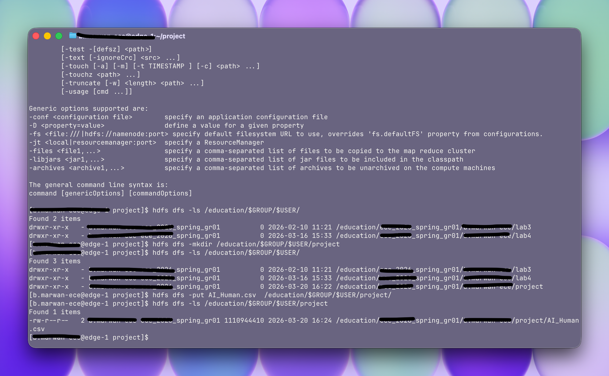

*Figure 1 – CSV upload to HDFS via the edge node (`hdfs dfs -mkdir` + `hdfs dfs -put` + `hdfs dfs -ls`).*

### **CSV health check**

`hdfs fsck` confirms the CSV’s integrity: **Status: HEALTHY**, 9 validated blocks, replication 2.0, 0 corrupt blocks, 0 missing replicas.

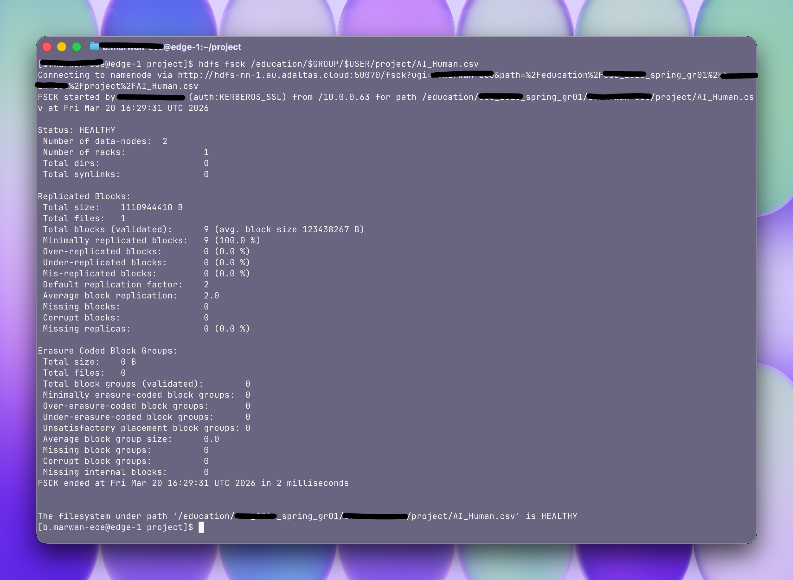

*Figure 2 – `hdfs fsck` on `AI_Human.csv`: HEALTHY, 9 blocks, replication 2.0.*

### **Parquet health check**

After local conversion and re‑upload, `hdfs fsck` also reports **HEALTHY** for the Parquet file: 5 validated blocks (581 MB vs. 1.1 GB for CSV), 0 corrupt blocks.

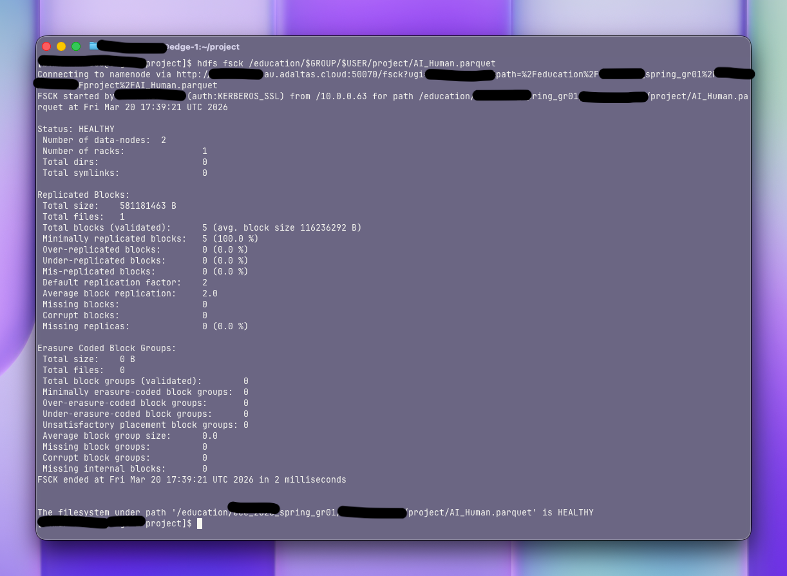

*Figure 3 – `hdfs fsck` on `AI_Human.parquet`: HEALTHY, 5 blocks, 581 MB.*

## **4.2 Hive Table Creation & Verification**

### **Beeline connection & main table creation**

Connection to HiveServer2 is performed with Beeline (JDBC). The table `login_AI_Human_ext` is created in Parquet format. Execution succeeds (≈ 0.36 s).

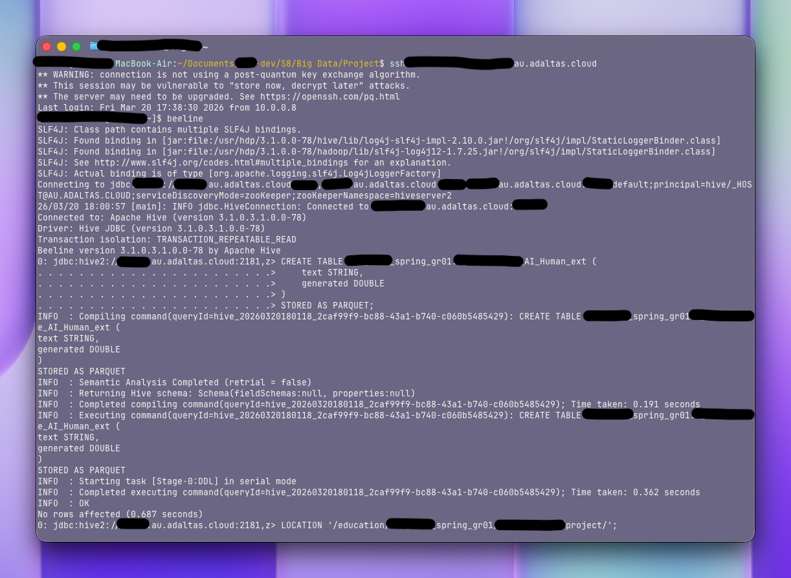

*Figure 4 – Beeline connection and creation of the main Hive table (`CREATE TABLE … STORED AS PARQUET`).*

### **Data loading & sanity check**

`LOAD DATA INPATH` loads the Parquet file into the Hive table (≈ 2.74 s). A `SELECT * LIMIT 1` shows a complete human text (`generated = 0.0`) about car usage.

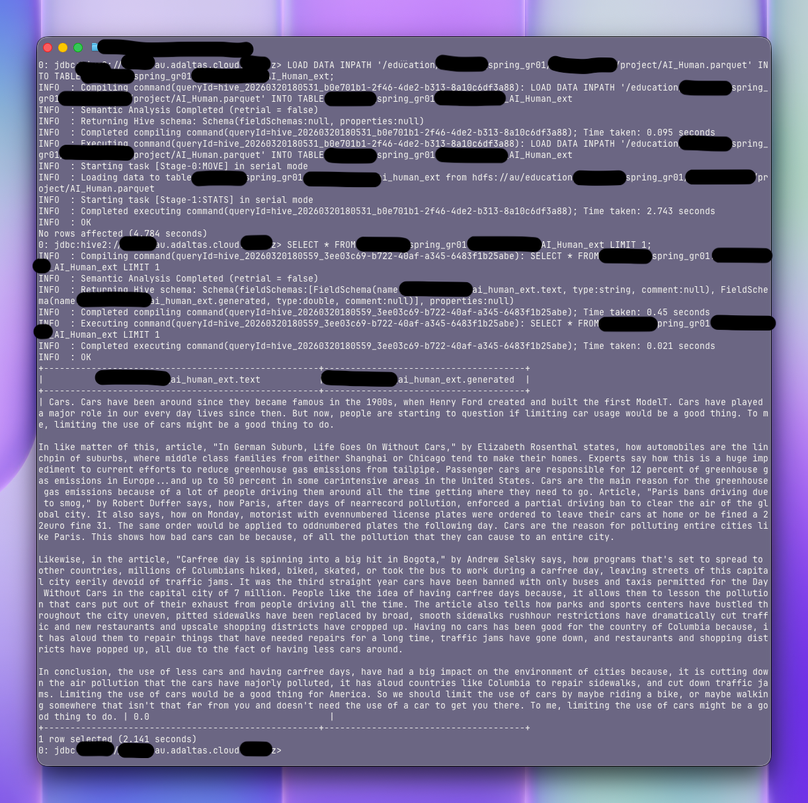

*Figure 5 – Data load and first‑row preview (`SELECT * LIMIT 1`).*

### **AI‑only table verification (`generated = 0.0`)**

`SELECT COUNT(*)` on `login_AI` triggers a MapReduce job (≈ 20 s) and returns only rows with `generated = 0.0`, confirming proper filtering.

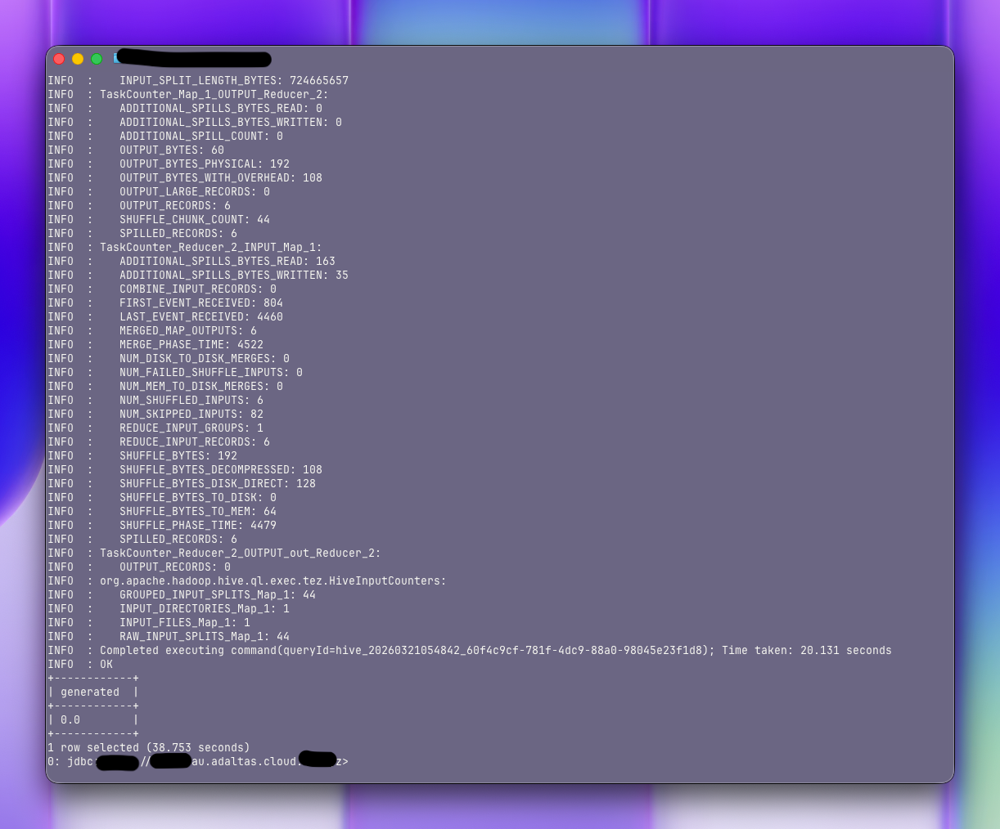

*Figure 6 – Verification of AI table: `generated = 0.0` confirmed (20 s YARN execution).*

### **Human‑only table verification (`generated = 1.0`)**

Similarly, `login_Human` returns only `generated = 1.0` rows (≈ 17 s), confirming correct segregation.


*Figure 7 – Verification of Human table: `generated = 1.0` confirmed (17 s YARN execution).*

### **Hive warehouse layout**

`hdfs dfs -ls` on the Hive warehouse shows the three project tables alongside those of other group members.

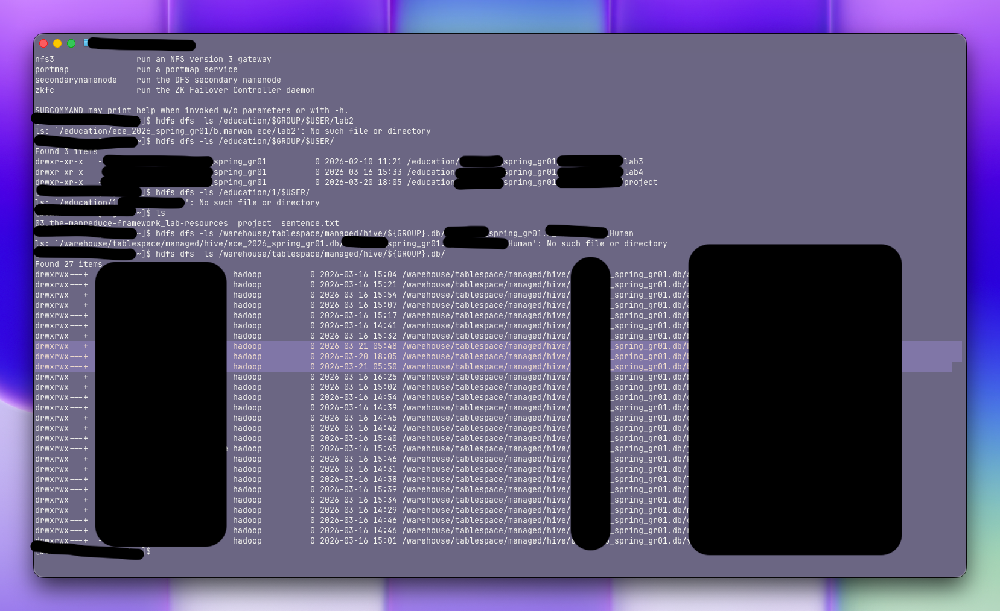

*Figure 8 – Hive warehouse directory listing; the three project tables are present.*

## **4.3 YARN Job Monitoring**

### **Running jobs**

The YARN ResourceManager UI (port 8088) displays the jobs while they are executing. A TEZ (Hive) job appears in **Running (0 %)** during the `INSERT OVERWRITE` word‑count steps.

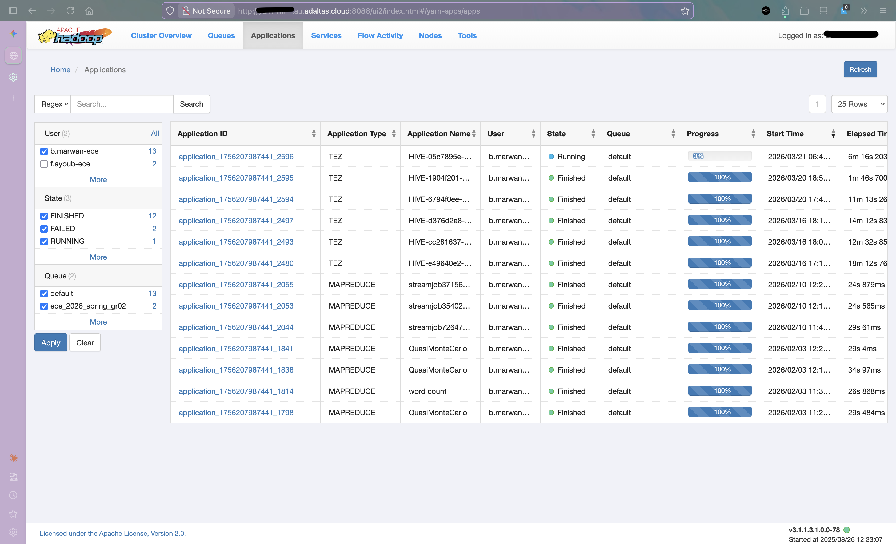

*Figure 9 – YARN UI: TEZ job in progress (Running 0 %).*

### **Completed jobs**

After all steps finish, the UI shows the full history for user `login-company`: TEZ (Hive) and MAPREDUCE (word‑count) jobs all marked **Finished** with 100 % progress.

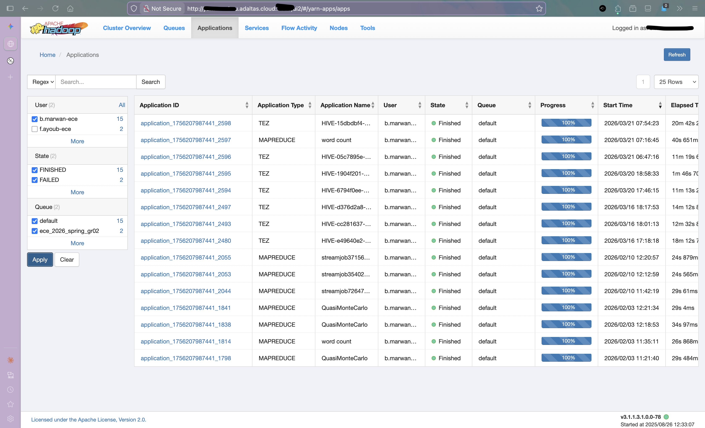

*Figure 10 – YARN UI final view: all jobs Finished 100 % (TEZ + MAPREDUCE).*

## **4.4 Word‑Count Results**

Top‑frequency queries were run on each of the three tables, enabling a lexical comparison between AI‑generated and human‑written texts.

### **Human texts**

| Word    | Occurrences |
| ------- | ----------- |
| **the** | 2 385 914   |
| **to**  | 2 110 020   |
| **and** | 2 081 531   |
| **of**  | 1 500 228   |
| **a**   | 1 490 881   |
| **in**  | 914 527     |

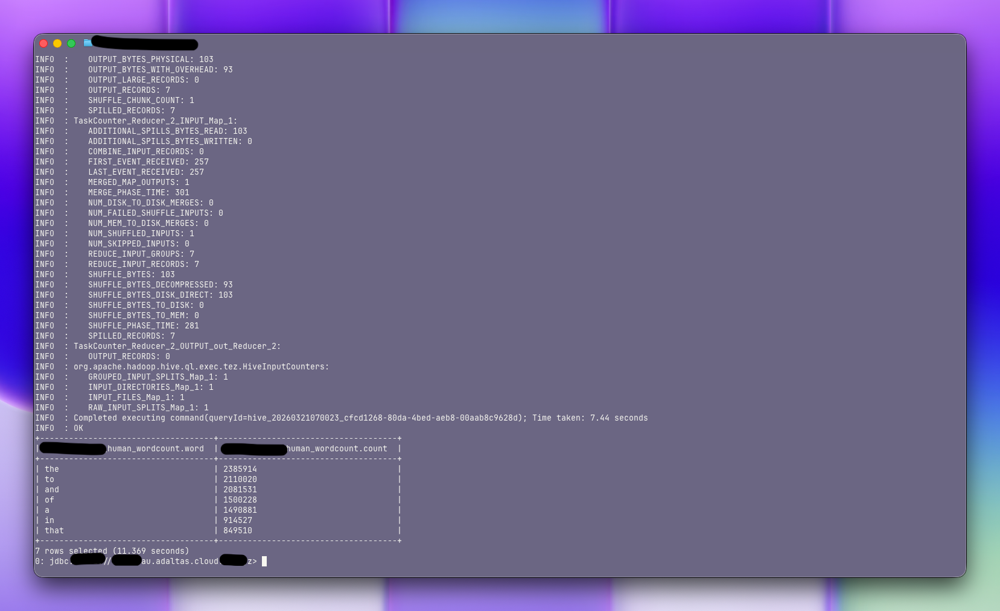

*Figure 11 – Human‑text word count (top 6 words); execution time ≈ 11.369 s.*

### **AI‑generated texts**

| Word    | Occurrences |
| ------- | ----------- |
| **the** | 5 464 227   |
| **to**  | 4 326 631   |
| **a**   | 2 930 396   |
| **and** | 2 823 005   |
| **of**  | 2 425 232   |


*Figure 12 – AI‑text word count (top 5 words); execution time ≈ 8.597 s.*

### **Full dataset (AI + Human)**

| Word    | Occurrences |
| ------- | ----------- |
| **the** | 7 850 141   |
| **to**  | 6 436 651   |
| **and** | 4 904 536   |
| **a**   | 4 421 277   |
| **of**  | 3 925 460   |

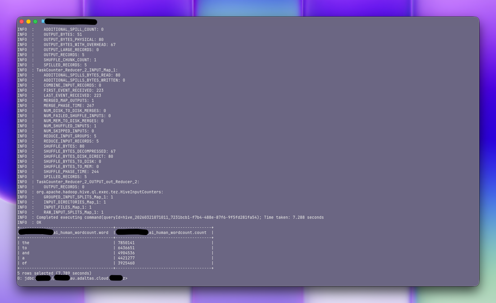

*Figure 13 – Word count on the whole dataset; execution time ≈ 7.789 s.*

### **Comparative observations**

* The AI subset contains a markedly higher count of **the** (5.4 M) than the human subset (2.4 M) despite comparable corpus sizes, suggesting a more rigid sentence structure in generated text.  
* **a** is also more frequent in AI texts (2.9 M vs. 1.5 M in human texts), whereas function words such as **in** and **that** appear more often in human texts.  
* These subtle stop‑word differences hint that richer features (TF‑IDF, n‑grams, syntactic patterns) could improve an AI vs. Human classifier.

# **5. Additional Features and Optimization**

To automate the whole workflow, we refactored the HQL code for simplicity.

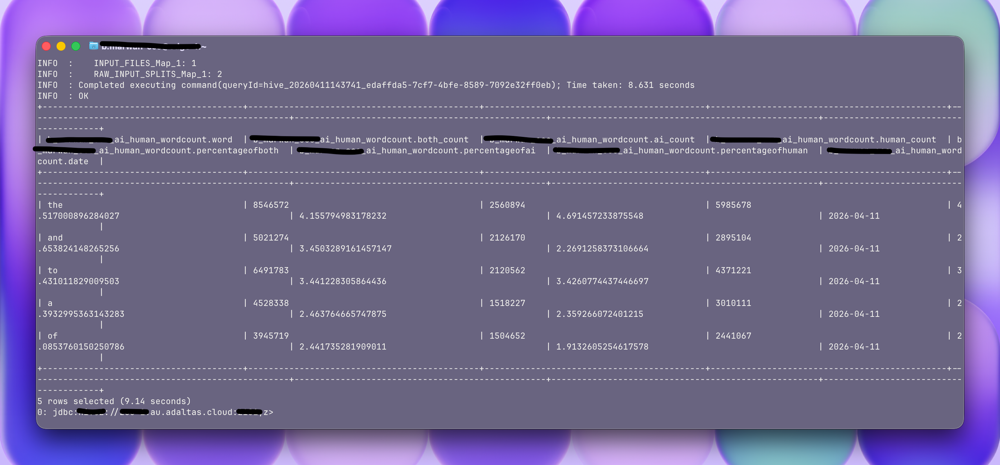

We then added a streaming branch: a second pipeline consumes a continuous data feed, aggregates its word‑count statistics with the latest batch results, and stores the combined view in a **Gold** Hive table that maintains a historical line per word.

A Python script simulates file arrivals in a *bronze* zone every 5 minutes. The script is called 'fake_stream.py'

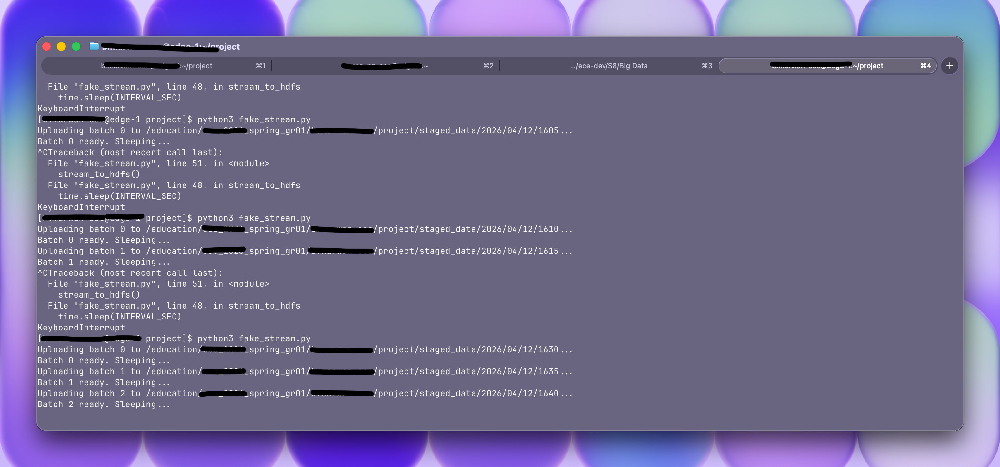

HQL scripts load the streamed files into a temporary *silver* table; another script merges the streamed word‑count with the most recent batch word‑count and inserts a new row into the *gold* zone.

An Oozie workflow orchestrates these scripts. The manual execution produces the following result:

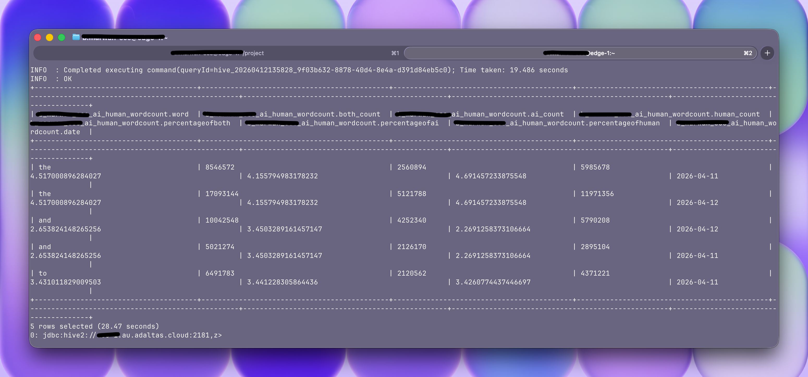

The `coordinator.xml` file was added to trigger the workflow automatically whenever new data land.

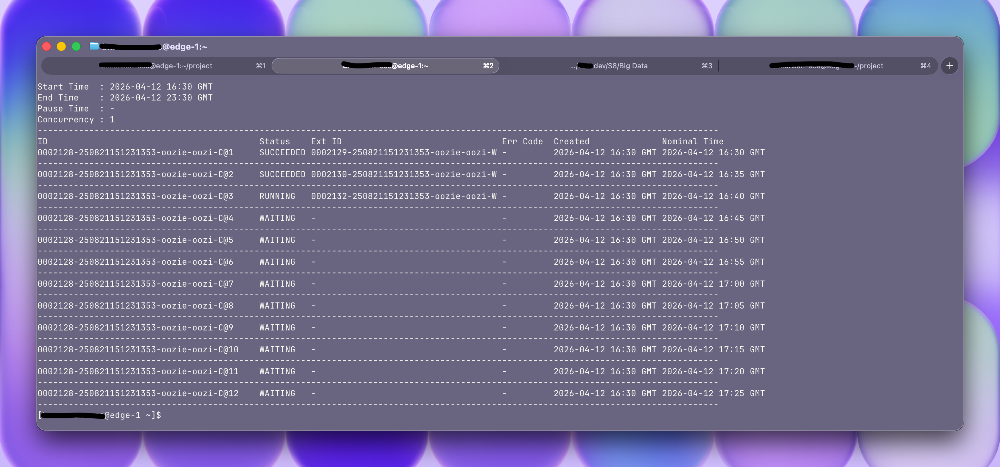

When the hybrid batch / stream pipeline is fully automated, the final Gold table looks like this:

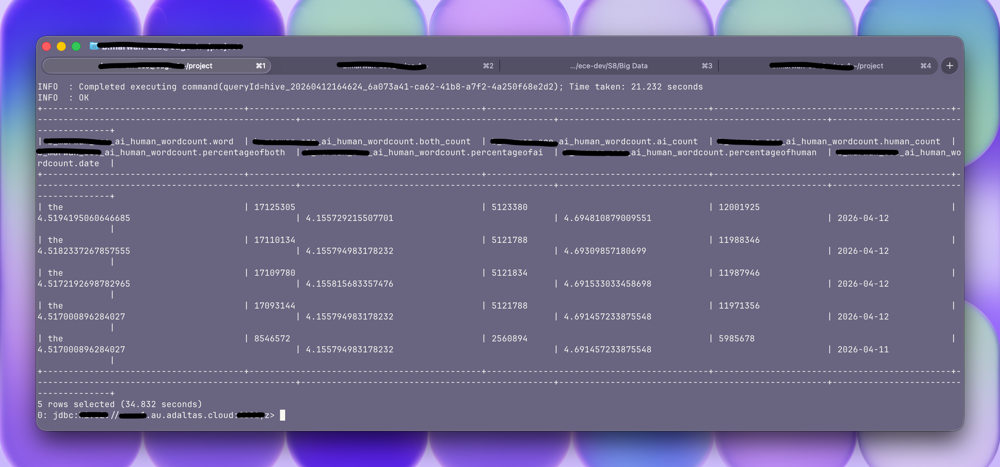

Here the final stats table where each row is dated to observe evolutions due to stream and batch sources. This output is automaticcaly generated by oozie workflow

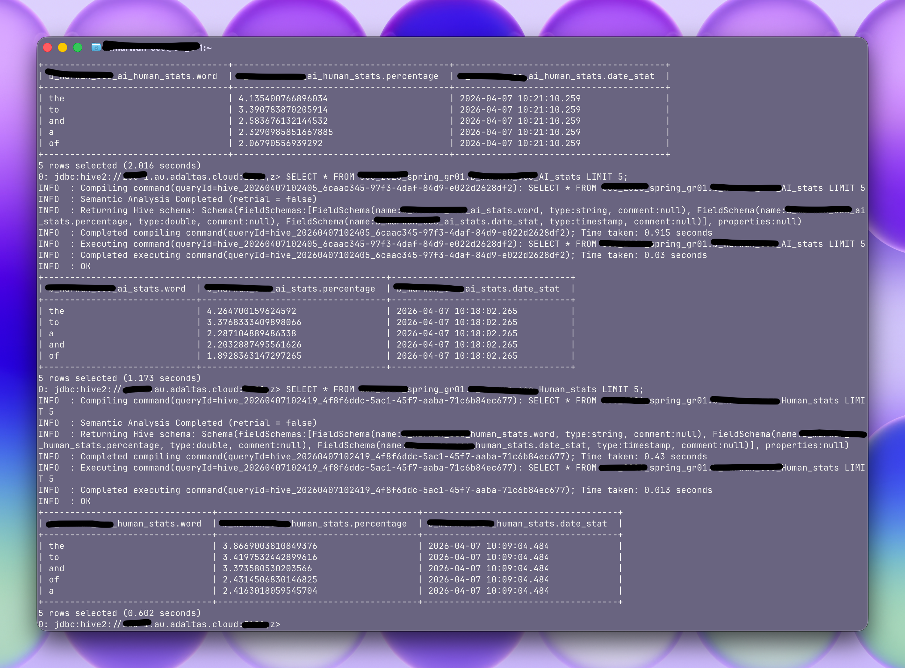

All scripts and configuration files are available in 'oozie_wf_project'.

# **6. Conclusion and Future Work**

This project allowed us to build a complete Big‑Data pipeline on the Hadoop ecosystem—from ingestion to result consumption. Every component was tested and validated:

* **HDFS** – distributed storage, `fsck` reports **HEALTHY**.  
* **YARN** – job orchestration.  
* **MapReduce/Tez** – distributed word‑count.  
* **Oozie & Hive/Beeline** – workflow management and SQL‑style querying.

The main challenges were handling the complex CSV format (solved by converting to Parquet) and the inability to run the native `wordcount` JAR on Parquet files (circumvented with HQL + `LATERAL VIEW`).

## **Possible extensions**

* **Hybrid batch / streaming** – add a cron job that injects new texts via Kafka to simulate a real‑time feed, completing a Lambda architecture.  
* **Machine‑learning pipeline** – use the word‑frequency vectors as features to train an AI‑vs‑Human classifier (Spark MLlib or scikit‑learn) directly on YARN.


*Report refactored by AI and can contains errors*