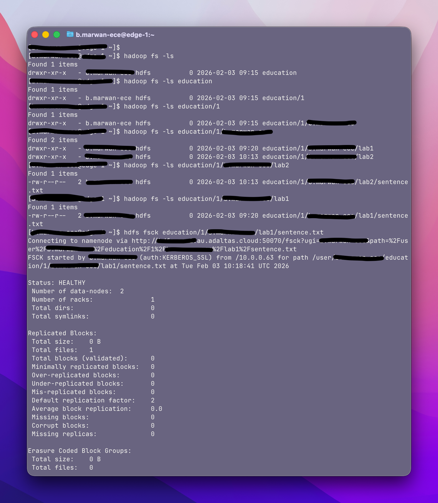
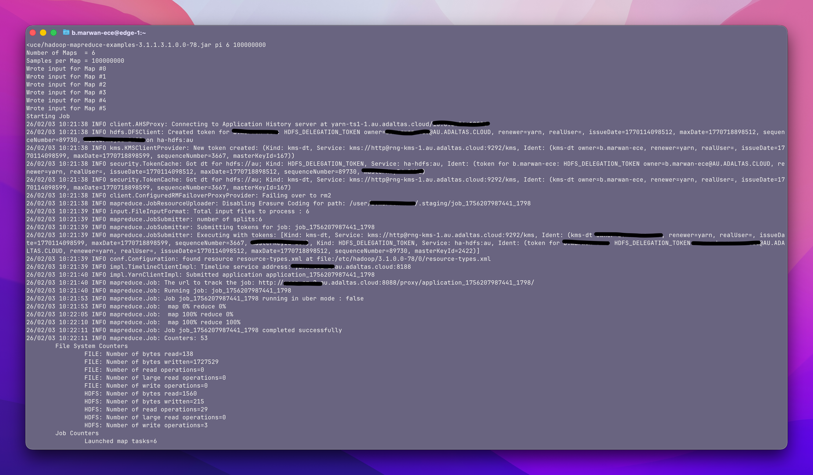
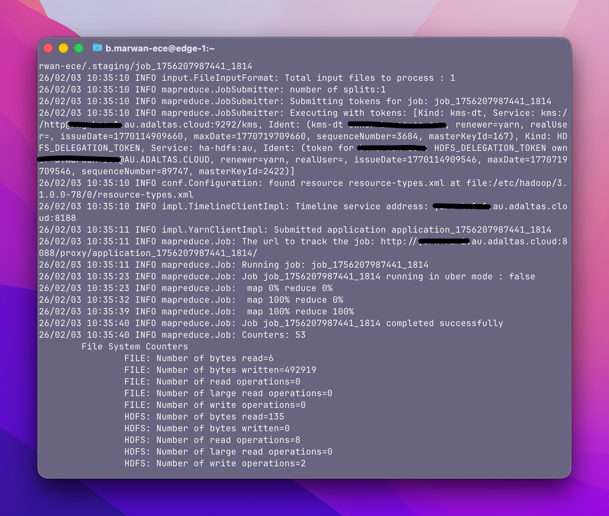
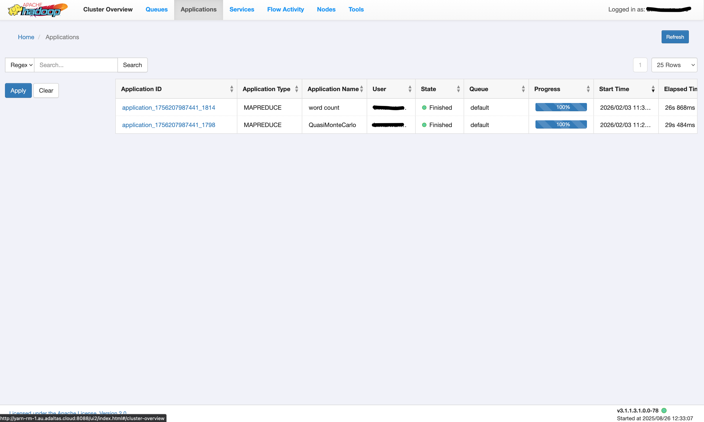
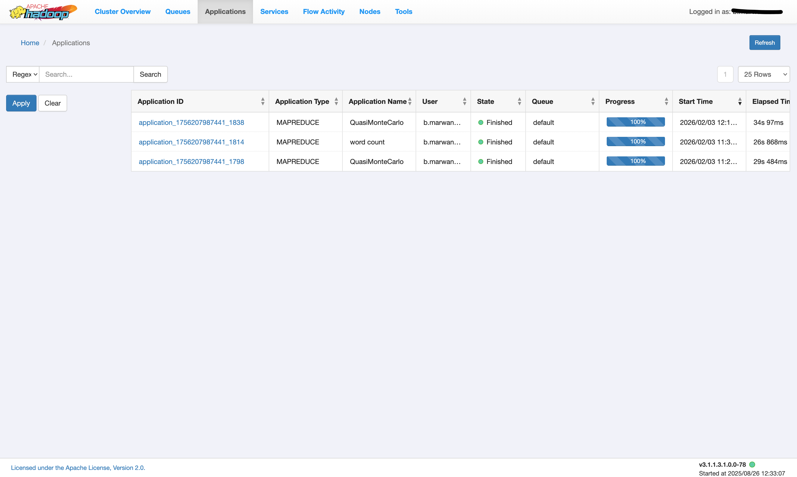

# Big Data Ecosystem

## HDFS and YARN interaction

**Before : setup env**

```bash
echo "export GROUP=1" >> ~/.bashrc
source .bashrc
```

### Create HDFS workspace and upload files to HDFS

```bash
hadoop fs -mkdir education
hadoop fs -mkdir education/$GROUP
hadoop fs -mkdir education/$GROUP/$USER
hadoop fs -mkdir education/$GROUP/$USER/lab1
hadoop fs -mkdir education/$GROUP/$USER/lab2
cd education/$GROUP/$USER
vim lab1/sentence.txt
    "I discover the tremendous Hadoop."
hadoop fs -put sentence.txt education/$GROUP/$USER/lab1/
hadoop fs -cp education/$GROUP/$USER/lab1/sentence.txt education/$GROUP/$USER/lab1/sentence.txt education/$GROUP/$USER/lab2/
hdfs fsck education/1/login/lab1/sentence.txt
```



## Submit an application in YARN

```bash
yarn jar /usr/hdp/3.1.0.0-78/hadoop-mapreduce/hadoop-mapreduce-examples-3.1.1.3.1.0.0-78.jar pi 6 100000000
yarn app -list
```




## WordCount example application

```bash
## 3
hadoop fs -ls education/1/login/lab2
yarn jar /usr/hdp/current/hadoop-mapreduce-client/hadoop-mapreduce-examples-3.1.1.3.1.0.0-78.jar wordcount education/$GROUP/$USER/lab2 education/$GROUP/$USER/lab2/output-moby-dick
```



## Setting up password-less SSH & Kerberos

```bash
## 4
ls -al ~/.ssh/id_*.pub
ssh-keygen -t ed25519 -C "email"
ls ~/.ssh/id_*

ssh-copy-id login@node.au.adaltas.cloud
ssh login@node.au.adaltas.cloud

vim /etc/krb5.conf
kinit login
```


## Accessing Hadoop Web UIs using Kerberos



```bash
ssh login@node.au.adaltas.cloud
yarn jar /usr/hdp/3.1.0.0-78/hadoop-mapreduce/hadoop-mapreduce-examples-3.1.1.3.1.0.0-78.jar pi 6 100000000
```




