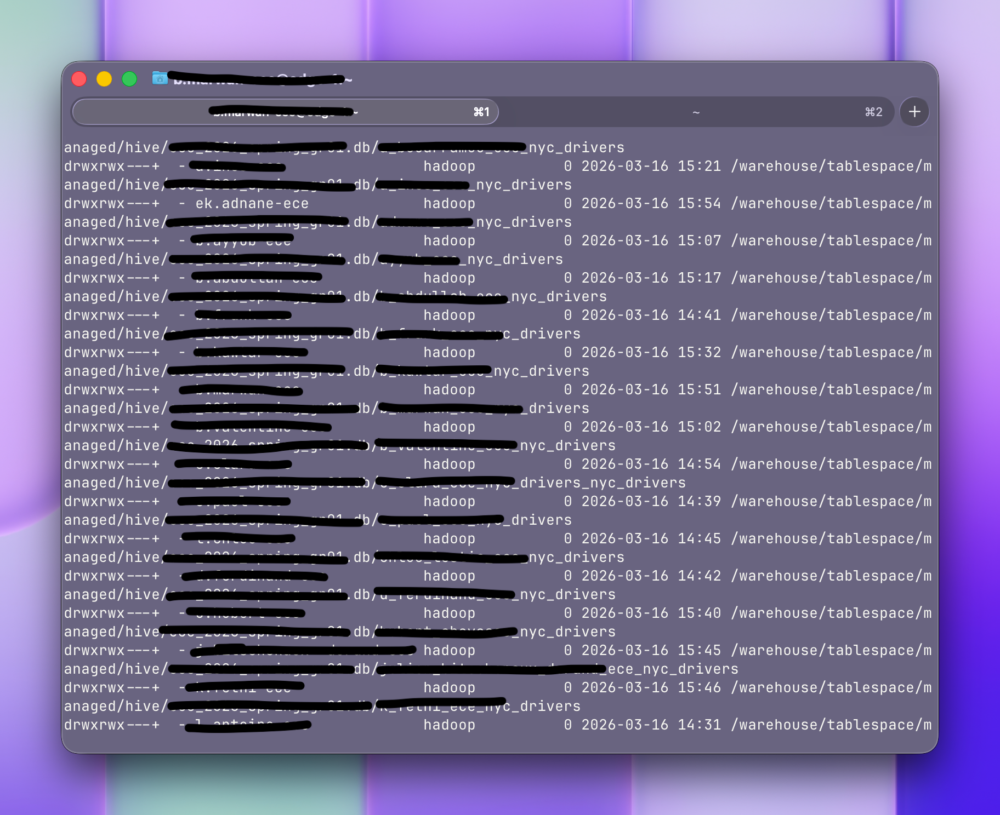
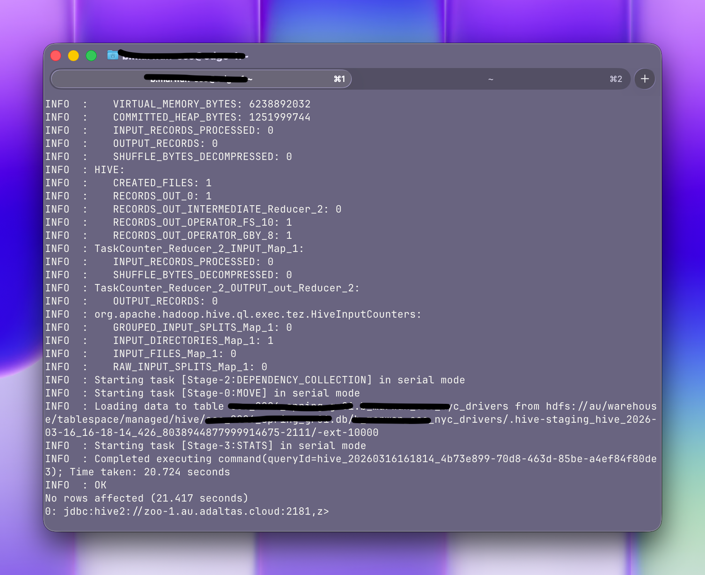
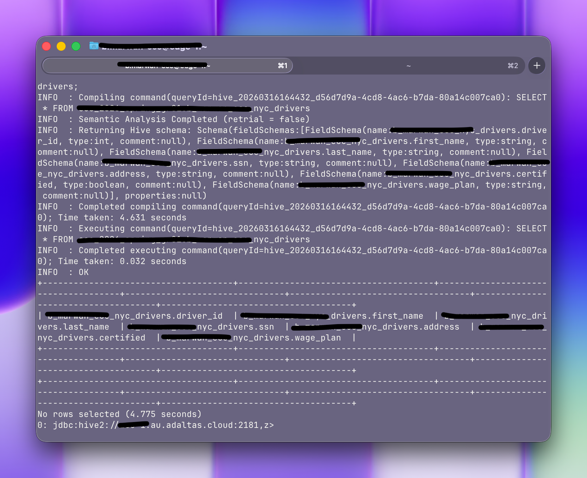
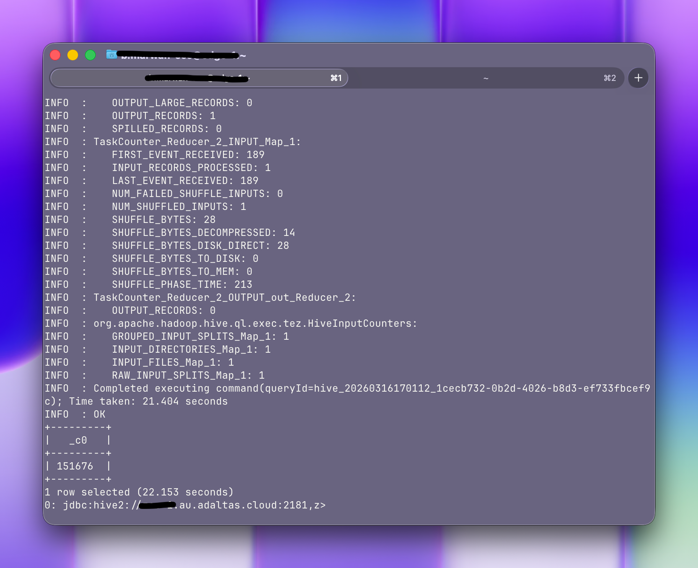
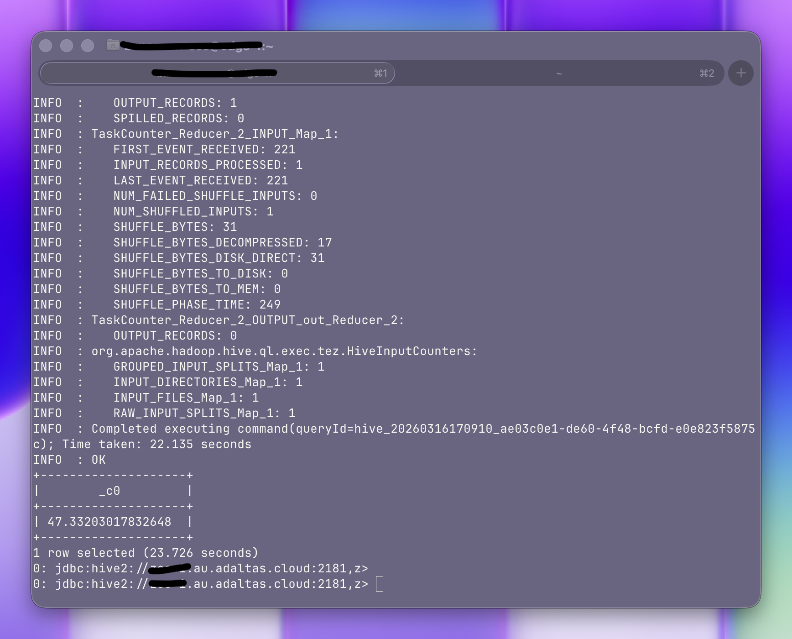
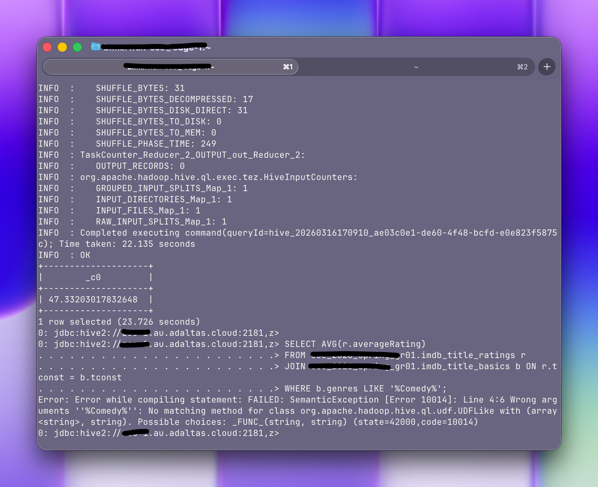
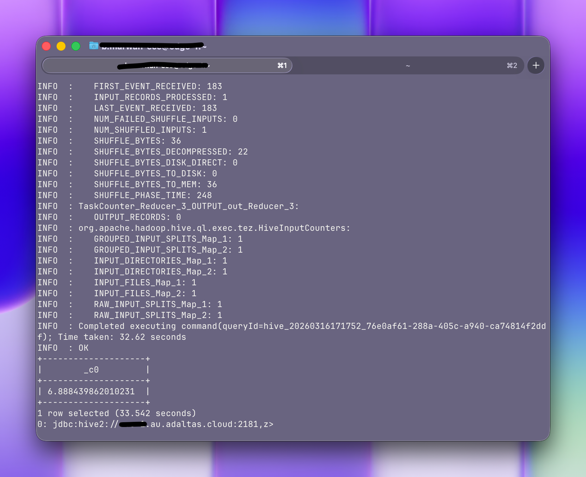
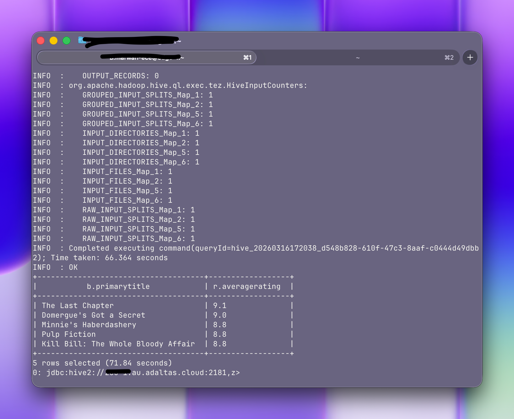

# Big Data Ecosystem

## Hive Warehouse

### Create an external table

```sql
SET hivevar:user=username;
SET hivevar:group=spring_gr01;
SET hivevar:hiveUsername=hiveusername;

CREATE EXTERNAL TABLE spring_gr01.hiveusername_nyc_drivers_ext (
  driver_id INT,
  name STRING,
  ssn INT,
  location STRING,
  certified STRING,
  wage_plan STRING
)
ROW FORMAT SERDE 'org.apache.hadoop.hive.serde2.OpenCSVSerde'
STORED AS TEXTFILE
LOCATION '/education/spring_gr01/hiveusername/lab4/nyc_drivers/drivers.csv'
TBLPROPERTIES ('skip.header.line.count'='1');
```

### Create a managed ORC table

```sql
CREATE TABLE ${group}.${hiveUsername}_nyc_drivers (
  driver_id INT,
  first_name STRING,
  last_name STRING,
  ssn STRING,
  address STRING,
  certified BOOLEAN,
  wage_plan STRING
)
STORED AS ORC;
```

```bash
hdfs dfs -ls /warehouse/tablespace/managed/hive/${GROUP}.db/
```



### Load data from the CSV table to the ORC table

```sql
INSERT INTO TABLE spring_gr01.hiveusername_nyc_drivers
SELECT 
  driver_id,
  split(name, ' ')[0] AS first_name,
  split(name, ' ')[1] AS last_name,
  ssn,
  location AS address,
  CASE 
    WHEN LOWER(certified) = 'y' THEN true 
    ELSE false 
  END AS certified,
  wage_plan
FROM spring_gr01.hiveusername_nyc_drivers_ext;
```



```sql
SELECT * FROM spring_gr01.hiveusername_nyc_drivers
```



________________________________________________________________________________________________

## Hive Query Language

### Queries

```sql
USE spring_gr01;
SELECT * FROM imdb_name_basics;
```

Sometimes, the session timed out. Thus we need to quit with :

```bash
!quit
```

and execute 'beeline' again.

```sql
SELECT COUNT(*) FROM imdb_title_basics WHERE runtimeMinutes > 120;
```



```sql
SELECT AVG(runtimeMinutes) 
FROM spring_gr01.imdb_title_basics 
WHERE primaryTitle RLIKE '\\b[Ww]orld\\b';
```



```sql
SELECT AVG(r.averageRating) 
FROM spring_gr01.imdb_title_ratings r
JOIN spring_gr01.imdb_title_basics b ON r.tconst = b.tconst
WHERE b.genres LIKE '%Comedy%';
```



```sql
SELECT AVG(r.averageRating) 
FROM spring_gr01.imdb_title_ratings r
JOIN spring_gr01.imdb_title_basics b ON r.tconst = b.tconst
WHERE b.genres NOT LIKE '%Comedy%' OR b.genres IS NULL;
```



- ```sql
  SELECT 
    b.primaryTitle, 
    r.averageRating 
  FROM spring_gr01.imdb_title_basics b
  JOIN spring_gr01.imdb_title_ratings r ON b.tconst = r.tconst
  JOIN spring_gr01.imdb_title_crew c ON b.tconst = c.tconst
  JOIN spring_gr01.imdb_name_basics n ON n.primaryName = 'Quentin Tarantino'
  WHERE array_contains(c.director, n.nconst)
  ORDER BY r.averageRating DESC 
  LIMIT 5;
  ```

