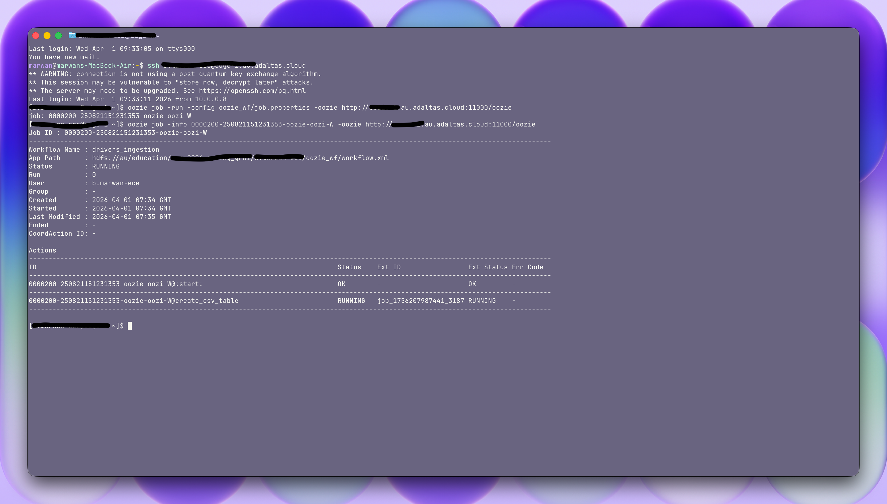
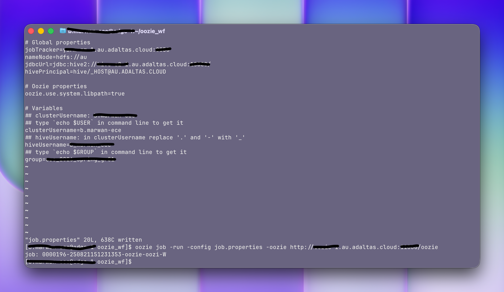
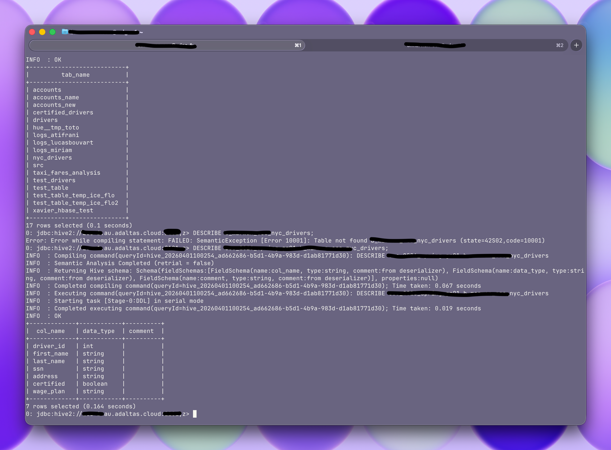
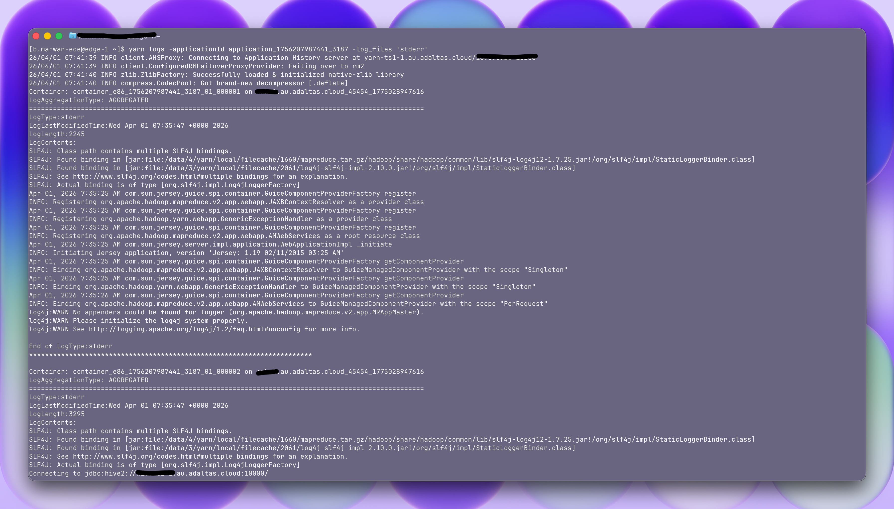
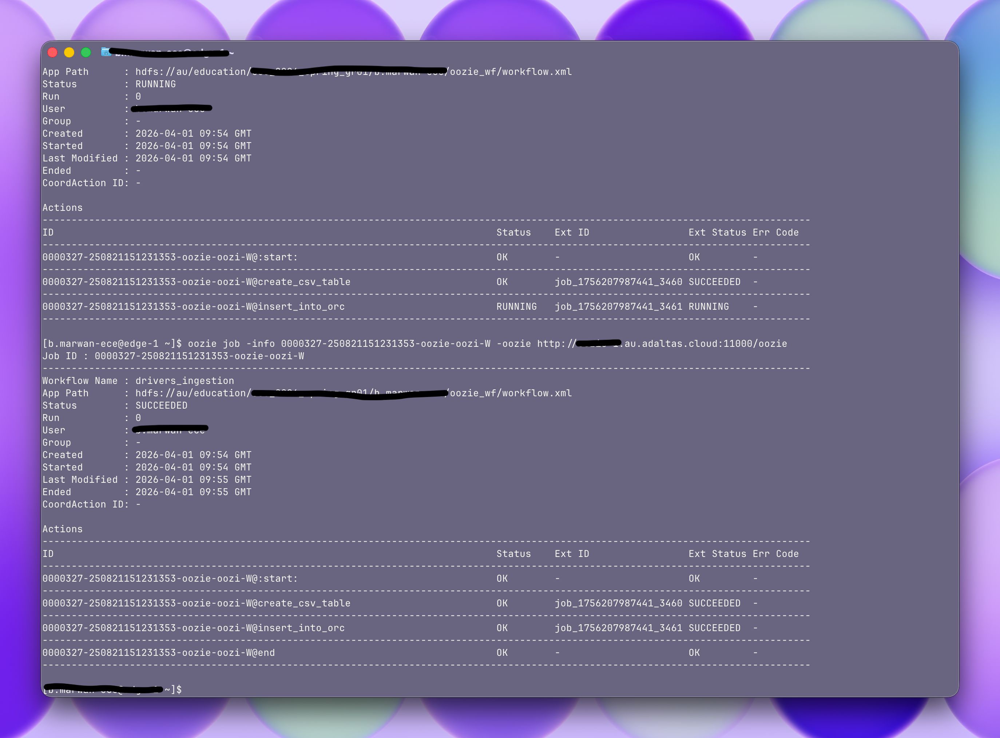
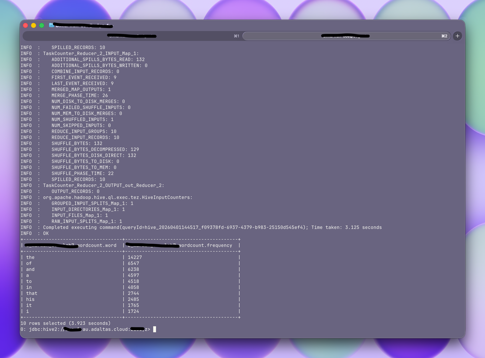

# Big Data Ecosystem

## Oozie with mapreduce and Hive warehouse

- I devoted a substantial amount of time to configuring the required files.

- The commands used to manage the jobs are relatively slow while the jobs are in execution.

- The commands I employed most frequently are:

```bash
hdfs dfs -put -f oozie_wf/ /education/$GROUP/$USER
oozie job -run -config oozie_wf/job.properties -oozie http://oozie-1.au.adaltas.cloud:11000/oozie
oozie job -info 0000310-250821151231353-oozie-oozi-W -oozie http://oozie-1.au.adaltas.cloud:11000/oozie
```


- I repeatedly edited **workflow.xml** and the associated HQL scripts.



- All the source files are located in the ⁠oozie_wf directory.

### Oozie word count, create a table and query it with HQL

- The complete code for this part can be found in the ⁠oozie_wf2 folder.

- To launch the Oozie job:

```bash
oozie job -run -config oozie_wf2/job.properties -oozie http://oozie-1.au.adaltas.cloud:11000/oozie
```

- To retrieve the status of a running Oozie job:

```bash
oozie job -info 0000431-250821151231353-oozie-oozi-W -oozie http://oozie-1.au.adaltas.cloud:11000/oozie
```






